# dyws

**Do You Want Something?** A reusable ordering and delivery system for a business’s own website.

**Release: [0.11.1](VERSION)** · [Optional install ZIP](https://github.com/Starlit-Digital/dyws/releases) · [Release notes](CHANGELOG.md) · [Installation guide](INSTALL.md) · [Hosted diner example](https://dyws.ca/)

The customer orders on your website, the business manages the order, and an assigned driver handles the delivery. Starlit Diner is the fictional restaurant example. The catalog also supports general products and services sold in whole units.

DYWS belongs in Starlit Digital's **Developer Tools**. [Starlit SiteCraft](https://sltd.ca/sitecraft/) uses its ordering and delivery capabilities when a client website needs them, alongside the shared template library, Starlit assets and accessibility preferences. A static template or contact form alone is not a DYWS integration. See [the product direction](docs/product-notes.md).

This is a development preview. Orders and delivery workflows work against persistent storage, but payments are demonstrations or Stripe sandbox transactions. Native mobile apps and production dispatch operations are not shipped. The repository contains the complete source; deployment credentials and business records stay outside Git.

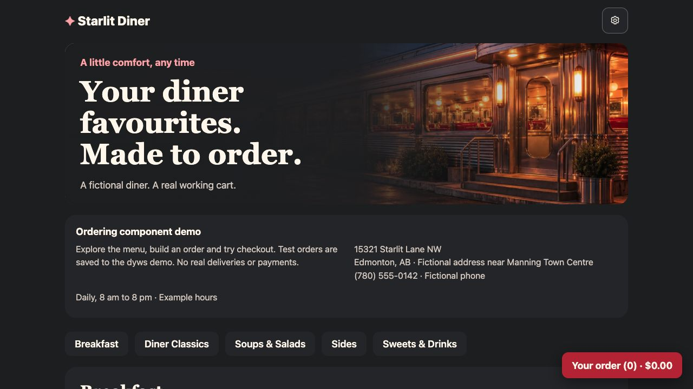

## Current checkout

Checkout uses one Location field with address autocomplete, an optional Unit field and phone formatting while typing. Selected addresses include city, province and postal code. The review uses two line addresses and an inline countdown between Back and Looks good!. Click the countdown to pause or resume from the remaining seconds. The control shows a play symbol while paused. Customer details stay in page memory across Back navigation and dialog close and reopen, until the order completes or the page reloads. All stages share divider free spacing and the available viewport height. Leaving the page pauses it until deliberately resumed. Canadian locality names are cached from the Statistics Canada National Address Register.

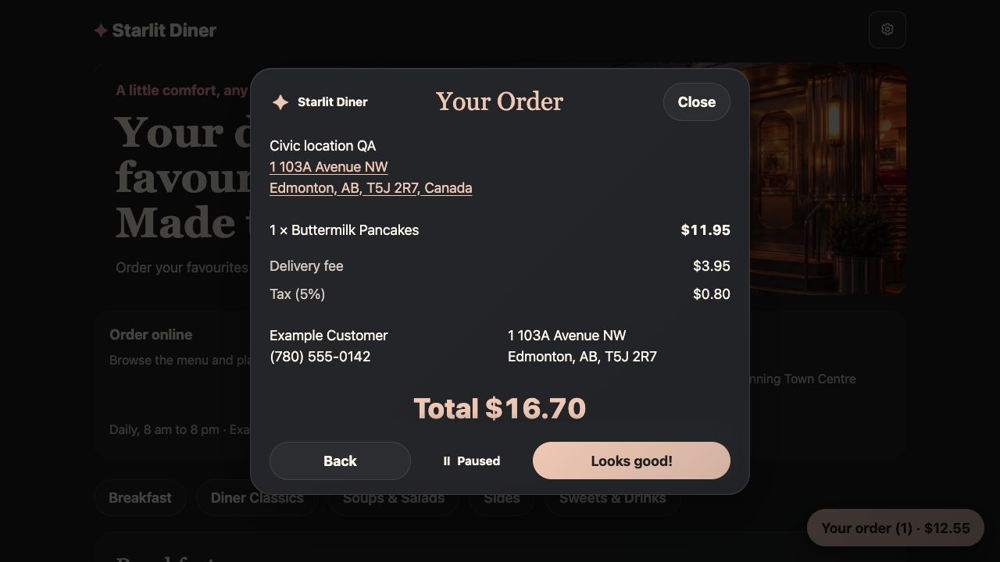

## Remembered guest details

Customers can choose **Remember my details on this device** without creating an account. Checkout offers Home, Work and custom address labels, an optional default address, individual removal and **Forget my details**. A new successful order renews a 180 day expiry for both the access cookie and private saved details. Browsing and retries of an existing order do not extend it. Customer contact details never go into browser storage.

[Terms and Conditions](public_html/terms/page.php) explains the feature and provides another removal control. Checkout and the storefront footer link to it. [The API contract](docs/api.md#remembered-guest-details) and [deployment notes](docs/deployment.md#remembered-guest-details) cover integration and cleanup.

## Install or run

The Git repository is the complete project: application source, bundled plugins, assets, examples, tests, build scripts and documentation. Clone it to develop or deploy dyws. Composer installs the locked PHP dependencies; the website does not need a ZIP or a frontend build.

For a merchant installation, clone the repository and run `composer install --no-dev`, then serve **only `public_html/`** over HTTPS. Keep all other directories outside the web root. Open `/setup/`, supply the private setup key, choose your administrator password and catalog, and finish installation. Setup removes itself and locks out repeat installation.

The optional release ZIP is a convenience for uploading to hosting without Composer. It contains the application and pinned PHP dependencies. Extract it and follow the same browser setup instructions.

Requirements: PHP 8.1 or newer, PDO SQLite, OpenSSL, curl, mbstring, and a writable private storage directory. See [INSTALL.md](INSTALL.md) for shared hosting, permissions, upgrades, and recovery precautions.

For a local developer demo:

```sh
git clone git@github.com:Starlit-Digital/dyws.git
cd dyws
composer install --no-dev
npm run setup
npm run serve
```

Open `http://127.0.0.1:8097/`. The CLI creates a disposable demo driver and generated credentials in ignored `var/LOCAL-ACCESS.txt`. Browser installation creates no default password or driver account. Node.js and Python 3 run tests and packaging tools; Node.js is unnecessary for ordinary PHP hosting. The optional WebSocket relay requires Node.js 22 or newer on a separate compatible server.

## Payment connectors

Separate optional [payment connector plugins](docs/payment-connectors.md) provide encrypted credentials, settings APIs, sandbox connection checks and event hooks for Square, PayPal, Helcim, Clover, Moneris and Authorize.net. These are integration foundations; Stripe remains the complete customer checkout integration. The Plugins page groups plugins by type in a vertical tab bar.

## Order forms

The optional [Order Format plugin](docs/order-format.md) adds a visual editor for Cart, Customer details and Final review. Arrange fields on a two column canvas, save named templates and assign a template to each stage. The existing order formats remain available whenever a stage has no template or the plugin is disabled.

## Public demo

Try [the storefront](https://dyws.ca/), [Admin](https://dyws.ca/admin/) with **admin / admin**, or [Driver](https://dyws.ca/driver/) with **driver / driver**.

The storefront's **Open Admin demo** and **Open Driver demo** buttons sign in automatically. The credential callouts appear at the top and bottom of the storefront; tracking and operator pages keep their normal focused layout.

This hosted install uses the mandatory [Installation Lockdown plugin](docs/demo-lockdown.md). Visitors can place and process shared fictional orders. Catalog, business settings, accounts, passwords and plugin configuration are locked on the server. Checkout uses fixed fictional contacts; device GPS and paid integrations are disabled. The map is a local reference image with a simulated driver position. Orders expire after 24 hours. Ordinary installations retain their own private credentials and configurable plugins.

The hosted public demo includes delivery runs, the connected tracking timeline and colour coded status badges. Delivery runs use simulated GPS and a local reference map; no device location or external routing is requested.

## Complete feature breakdown

### Customer ordering

| Area | Included behavior |
| --- | --- |
| Catalog | Categories, items, descriptions, images with alternative text, prices, SKU, unit labels, availability, option labels and priced variants. Private JSON is the source of truth. |
| Host integration | Reusable PHP rendering functions, JavaScript modules, `<dyws-ordering>`, scoped `dyws` CSS classes and theme variables. Hosts can render selected categories and hydrate existing panels. |
| Diner example | Five categories with seven items each, category photographs, a diner hero, responsive layout, and fictional business details. |
| Display preferences | The diner provides an adjustable light to dark palette and an 18 to 24 pixel font size control, with generous touch targets. |
| Cart | Visible item quantities, increment and decrement controls, removal icons, options, subtotal, tax, delivery fee and final total. |
| Checkout | Configurable per item cap, default 10 across options, with a call the store prompt for larger orders. Pickup or delivery, customer name, phone, structured street address, optional unit, city, province or state, postal code, country and order notes. |
| Server validation | Product and option validation, quantity limits, integer cent calculations, authoritative pricing and idempotent order submission. Client totals are not trusted. |
| Confirmation | A final review with item prices, delivery fee, tax and total, plus Back and Looks good!, counting down from 10 before sending. Click to send sooner, pause for more time, or go back without creating an order. Closing or hiding the page cancels or pauses the countdown. A unique order reference and a private order status page after checkout. The tracking token handoff leaves only the order reference in the page URL. |
| Progress | A connected, accessible timeline for Received, Confirmed, Preparing, Ready, On the way and Delivered, plus pickup and cancellation states. Run customers see how many stops remain ahead. Driver completion updates the customer view. A pending confirmation notice, order receipt, fulfillment details and business contact link keep the page useful while waiting. Polite announcements report meaningful changes, with reduced motion support. |
| Arrival estimates | Google route estimates when a current driver location and usable route are available. Otherwise the page explains when an estimate can be shown. |
| Update recovery | Automatic polling or optional WebSocket updates, refresh on return to tracking, recovery from stalled reads and clear delayed update messages. |

Drivers edit their optional vehicle model and colour under My profile. Colour selection offers 32 named swatches, each 16px square. Customers see their assigned driver and vehicle on their private tracking page.

### Business administration

| Page | Included behavior |
| --- | --- |
| Entry and sign in | `/admin/` is the natural entry. Protected PHP pages redirect to `/auth/` before emitting admin markup. Successful sign in opens Orders. |
| Orders | Active orders first, compact DataTables search, sorting, pagination and filters for date, status, fulfillment and payment. Date presets include Today, Yesterday, This week and This month, using the business timezone. Completed and cancelled orders remain accessible. Colour coded badges distinguish status, fulfillment and payment. |
| Delivery runs | Group up to twenty ready deliveries for one driver, arrange stops before departure, start all stops together and complete them in order. One browser GPS stream serves every remaining active delivery. |
| Order details | Customer contact and delivery address, ordered items, notes, allowed status transitions, driver assignment, payment status and delivery location details. |
| Reports | Date range, currency and fulfillment filters; previous period comparisons; order and payment charts; active, completed and cancelled totals; popular items; preparation and delivery durations; daily and hourly tables. |
| Exports | CSV report data and downloadable SVG charts. Report definitions distinguish ordered value, test collections, refunds, tax and delivery fees. |
| Catalog editor | Add, rename, reorder and remove categories, items and options; edit descriptions, image paths, prices and availability; save validated JSON with revision conflict checks. |
| Drivers | Add, edit and deactivate driver accounts, update credentials, inspect assigned active orders and view individual location panels. An open account editor remains protected during refreshes. |
| Password | Change the administrator password using the current password. Password changes revoke admin sessions. Background refresh never repopulates password fields. |
| Settings | Business name, platform display name, pickup address, phone, email, Item Order Cap, tax, delivery fee, timezone, and arbitrary singular and plural role labels. Currency is displayed from the catalog. |
| Plugins | Discover bundled plugins, activate or deactivate them, view status and open their settings. Stored plugin configuration survives deactivation. |
| Automatic refresh | Admin views refresh when returning to a visible tab or window and when connectivity returns. Clean forms update independently; unsaved values, focused fields and open editors defer replacement. |
| Edit protection | Saved revisions remain attached to drafts. A read that overlaps typing, saving or explicit reload cannot overwrite newer edits. Deferred changes produce a notice. |

### Business locations

Add and edit location rows in Business details. Each row has a name, address, optional phone and availability control. Checkout selects a location and the saved order retains that branch even if business details change later. Pickup addresses in checkout and final review open Google Maps in a new tab. Catalogs without location rows continue to use their single pickup address. See [the API contract](docs/api.md#business-locations-october-24-2026).

### Driver and delivery flow

Drivers can choose their map and profile icon under **Driver console → My profile**. Car is the default, with SUV, Pickup, Van, Motorcycle and Bicycle available. The same saved icon appears across the driver console, admin maps and private customer tracking.

Drivers sign in at `/driver/` and see only assigned deliveries available to their account. The console shows the delivery address, phone, notes and pickup or completion actions. Status transitions are checked by the server.

Browser GPS starts automatically for an assigned delivery that is on the way, subject to browser permission. Location is scoped to the assigned active order. The admin and that order’s customer can see its position, timestamp and stale position warnings. Completion and sign out stop location sharing. A private simulated origin is available for testing without sharing a person’s location.

The console refreshes on tab return, window focus and reconnection. Reliable GPS while a phone is locked or an app is in the background requires the planned native apps; the browser console does not provide that guarantee.

### Bundled plugins and extension points

| Plugin | Features |
| --- | --- |
| Installation Lockdown | Optional mandatory policy for an isolated public demo, protected settings, fictional checkout data, simulated GPS and temporary records. |
| Google Maps | Driver and destination markers, driving routes, estimated travel time, location and route caching, fallback links, and private plugin settings for the browser key and map ID. |
| Stripe | Optional sandbox hosted Checkout, signed webhooks, server payment verification, idempotency, encrypted credentials and settings owned by the plugin. Success and cancellation return to the private order page. No live payment keys in this demo. |
| Order Reporting | Reporting dataset, business metrics, period comparisons, charts, CSV and SVG exports, dashboard controls and report integration hooks. |
| DataTables | Locally bundled table search, sort, pagination and in memory table state. No runtime CDN dependency or customer records in browser table storage. |
| Order Format | Optional visual layouts for Cart, Customer details and Final review, with built in defaults when disabled or unassigned. |
| Nominatim Address Lookup | Optional suggestions from an owned address service, including Alberta civic address matching. Manual entry remains available. The public demo uses fictional local suggestions. |
| Square, PayPal, Helcim, Clover, Moneris and Authorize.net | Six independent sandbox connector foundations with encrypted settings, connection checks and verified event hooks. They do not enable customer checkout. |

The [plugin system](docs/plugins.md) provides lifecycle, discovery, settings, authenticated routes, validators, filters, actions, UI slots and providers. The [40 hook contracts](docs/plugin-hooks.md) cover catalog validation and display, checkout fields and validation, order creation and transitions, assignment, tracking, lookup, API responses, driver tools, reporting datasets, controls, cards, exports, tables and payment connectors. The [gift note example](examples/plugins/gift-note) demonstrates a custom plugin.

Native PHP `#[Provides(...)]` attributes describe plugin features. Page `#[Requires(...)]` attributes declare what each page consumes. The resolver loads matching browser assets while keeping required backend validation and authorization active. A new page does not need every plugin’s browser code.

### Storage, security and performance

| Area | Implementation |
| --- | --- |
| Persistence | SQLite stores orders, line items, events, payment records, accounts, sessions and active location records. Private JSON stores the catalog, site configuration and plugin settings. |
| Access | Tenant scoped APIs, manager and driver roles, assignment checks, private customer tracking tokens, password hashes, session revocation, login rate limits and CSRF protected browser sign in. |
| Payments | Manual test capture and full refund records, or configured Stripe sandbox Checkout. Browser redirects never mark a Stripe order paid. |
| Time | UTC timestamps internally; an administrator selected timezone for local display and reporting boundaries. |
| Initial rendering | PHP supplies authorized initial data and readable page previews. JavaScript handles updates, actions, maps and interactive controls. Skeletons cover controls while they initialize. |
| Assets | Page specific editor imports, plugin feature resolution, generated module preloads and revalidated static assets. Authenticated HTML and API responses use no store caching. |
| Communication | HTTPS polling works on ordinary PHP hosting. An optional scoped WebSocket relay provides invalidations and RPC, with HTTP fallback and no automatic replay of uncertain writes. |
| Diagnostics | Opt in `?diagnostics=1` measurements for startup, API reads, rendering and maps, without recording tokens, request bodies or customer contact details. |
| Installation | Git plus Composer, with an optional install ZIP containing dependencies and a file hash manifest. Ownership key setup, administrator creation, installer removal and reinstall protection. |
| Maintenance | Documented backups, account migration, cleanup tooling and separate private runtime storage. These tools are not automatically scheduled by installation. |

## Screenshot examples

These browser screenshots were captured from isolated local fixtures on October 23, 2026. The Orders, delivery run, driver, reporting, plugin, checkout and tracking images show the current development build. Names, phone numbers and addresses are fictional. No live customer records, real credentials, Maps keys or tracking tokens appear. The Google Maps API is unconfigured in this screenshot fixture, so its screens do not demonstrate a live route estimate.

### Business owner

**Orders:** active work appears first, with searchable rows and distinct status, fulfillment and payment badges.

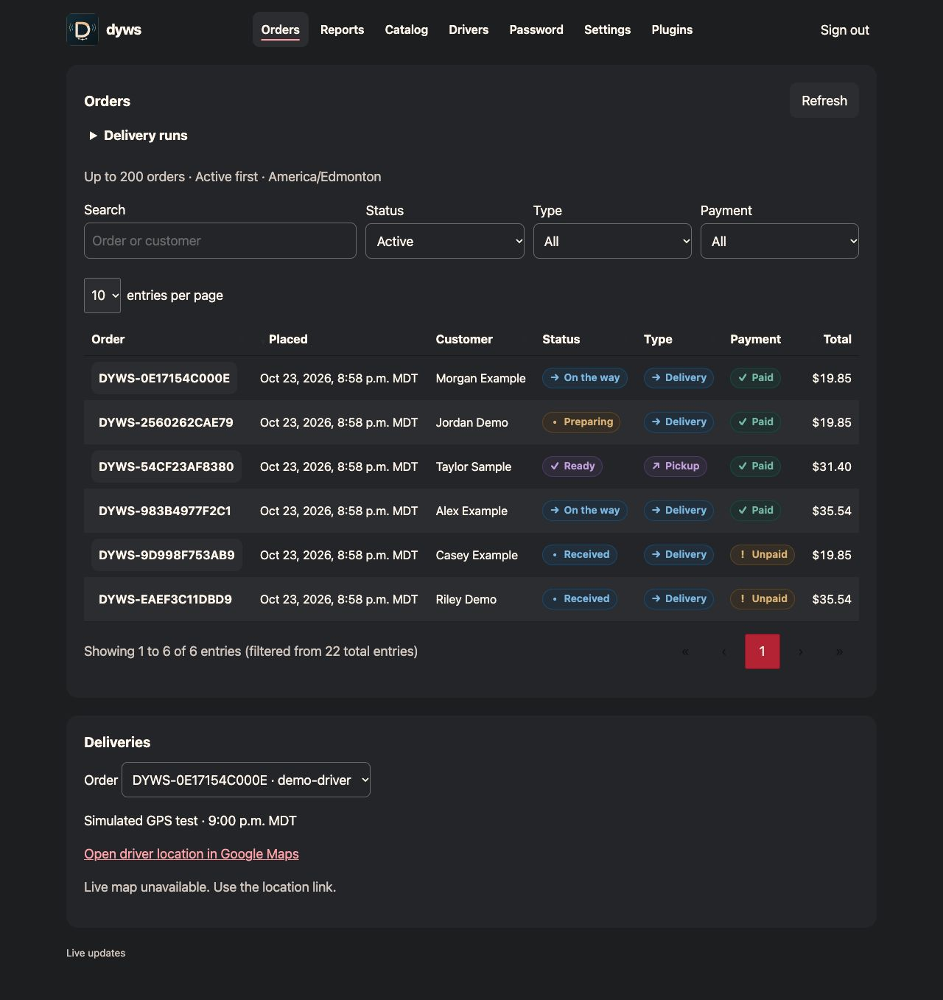

**Delivery runs:** one driver follows an ordered list of stops, with each customer seeing only their own delivery progress.

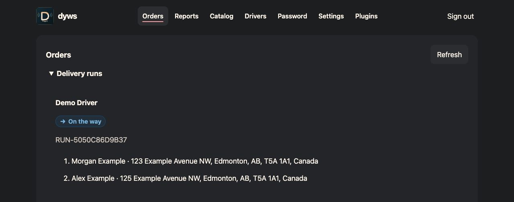

**Order details:** grouped customer information, item prices and clearly labelled actions.

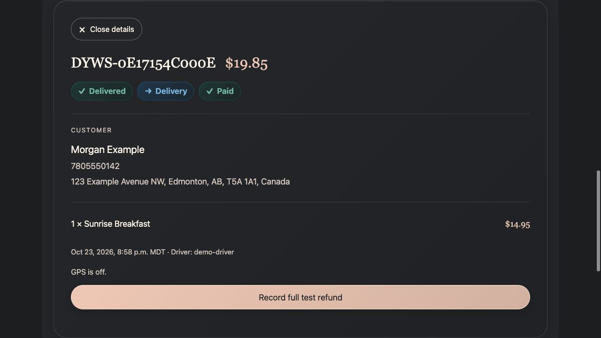

<details>
<summary>Reports, Catalog and Plugins examples</summary>

**Reports:** business metrics, charts and drill down tables.

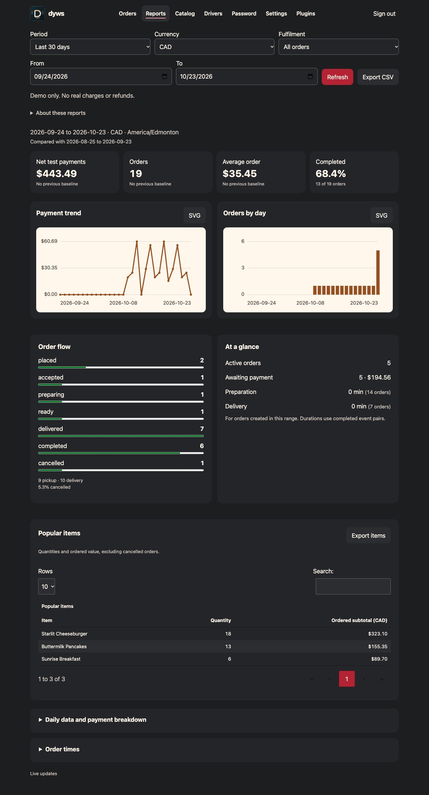

**Catalog:** category and item editing backed by private JSON.

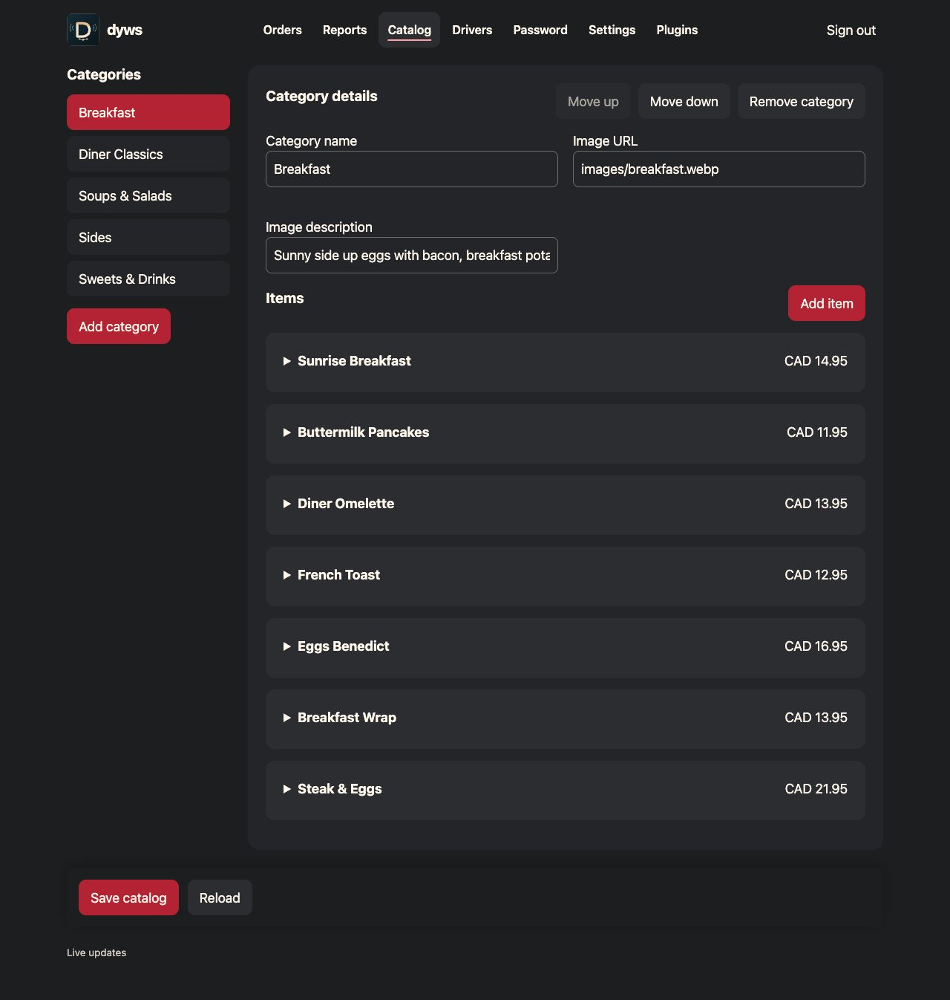

**Plugins:** bundled feature activation and settings links.

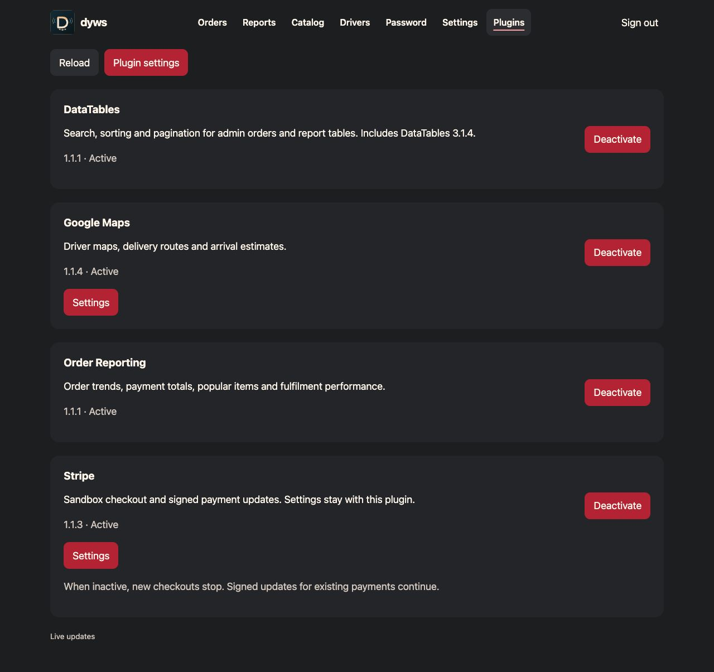

</details>

### Driver

**Sign in:** a driver ID and password, separate from administrator access.

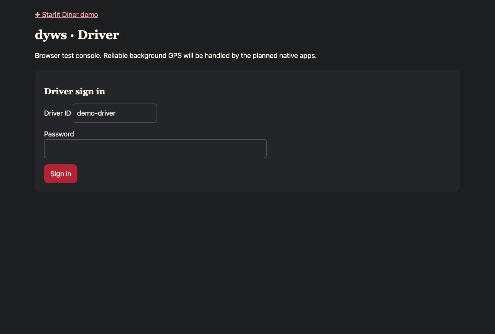

**Delivery run:** ordered stops, payment and delivery badges, and a clear action to complete the next stop.

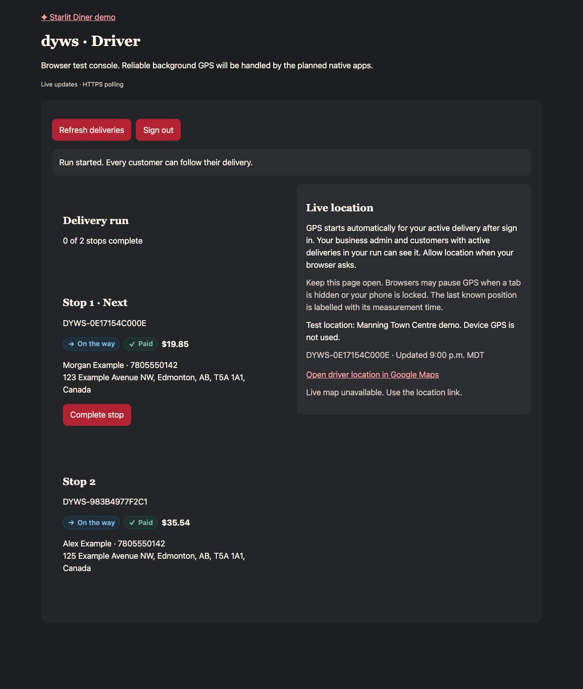

### Customer ordering process

1. Browse category panels and add items. Product quantities remain visible.

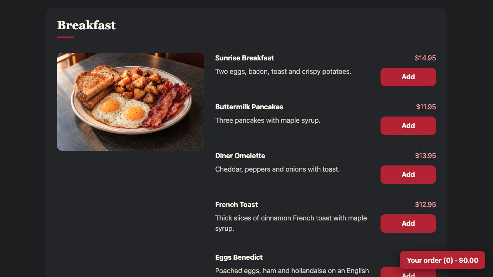

2. Review quantities and totals in the cart.

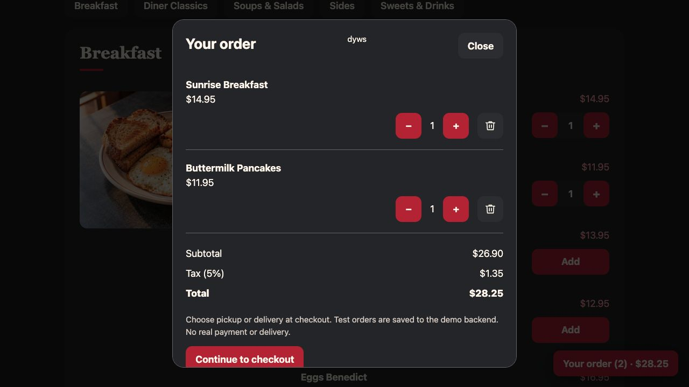

3. Choose Pickup or Delivery with the pill selector, then provide contact and address details. The delivery fee is shown with the choice.

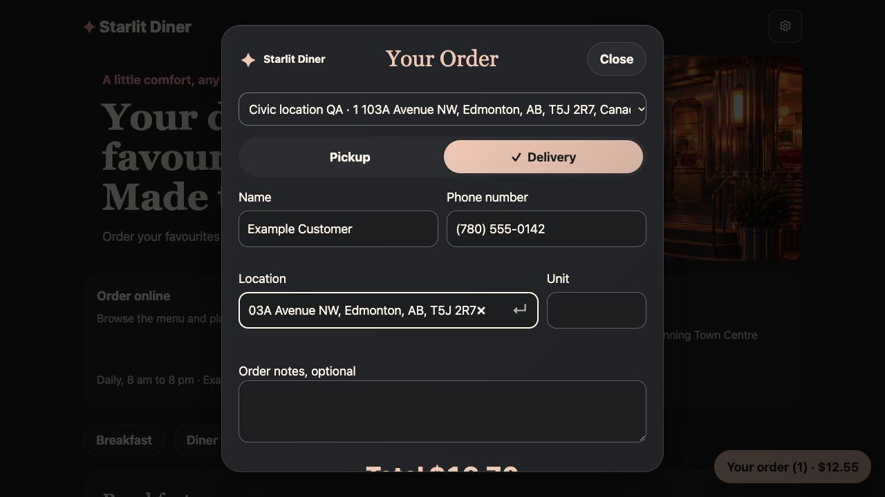

4. Follow the connected progress timeline. Later stops show how many deliveries are ahead.

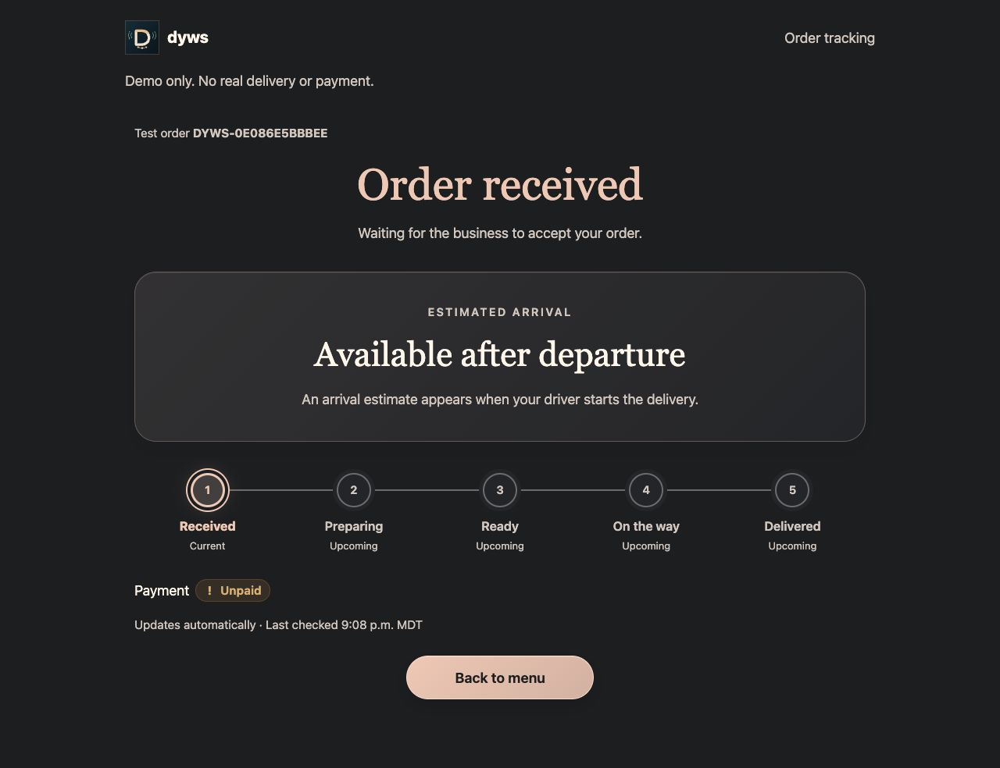

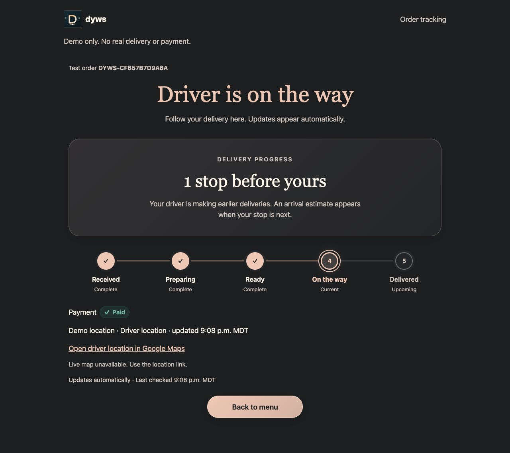

5. When the assigned driver completes delivery, the same page confirms completion and removes active location tracking.

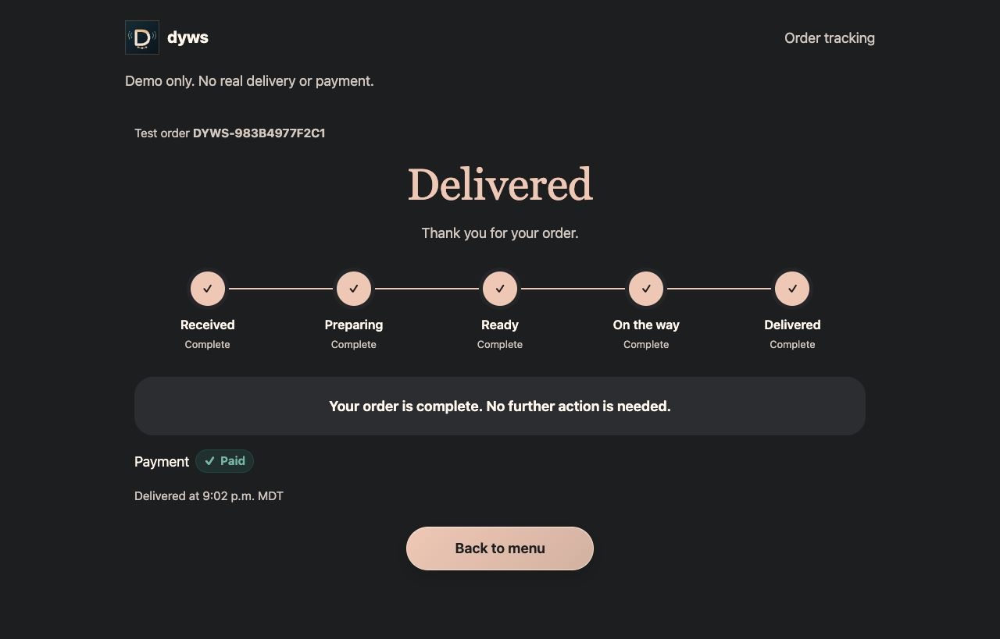

## Integration and project layout

| Path | Purpose |
| --- | --- |
| `public_html/` | The only public document root, containing PHP pages, assets and thin site adapters. |
| `public_html/dyws/` | Reusable JavaScript modules, web component and scoped CSS. |
| `modules/dyws/php/` | Private reusable rendering, storage, authorization and plugin code. |
| `modules/dyws/realtime/` | Optional separately hosted Node.js WebSocket service. |
| `plugins/` | Private bundled plugin implementations and manifests. |
| `public_html/plugins/` | Matching browser assets for bundled plugins. |
| `examples/` | Diner and general store catalogs, PHP host integration and plugin examples. |
| `tests/` | Automated application, API, plugin and installation checks. |
| `scripts/` | Asset preparation and optional release packaging tools. |
| `services/nominatim/` | Separately hosted address service configuration, civic import, matching tests and operations guide. |
| `dist/` | Ignored generated install ZIP and checksum, created only when requested. |
| `var/` | Ignored runtime data and credentials. Never publish this directory. |
| `docs/` | Architecture, APIs, deployment, screenshots, plugin contracts and plans. |

Use [the PHP module calls](docs/dyws-module.md) to render categories and item panels in your own host page. Supply the host endpoint and authenticated tenant configuration to the browser package. Use the current `dyws` identifiers and directory routes; obsolete HTML routes and earlier component names are not supported.

## Verification and releases

```sh
composer install --no-dev
npm ci --prefix modules/dyws/realtime
npm test
npm run test:realtime
python3 -m unittest discover -s services/nominatim/autocomplete -p 'test_*.py'
```

Optionally build and verify an install download:

```sh
npm run build:zip
npm run verify:release
DYWS_INSTALL_ARCHIVE="$PWD/dist/dyws.zip" python3 tests/installer.test.py
```

`VERSION`, the root package and the browser package share the application version. Bundled plugins and the optional relay retain their own component versions. The builder checks version alignment, includes the locked PHP dependencies, excludes runtime files and writes `MANIFEST.json` inside the ZIP. Stage new source files before building. Generated `dist/dyws.zip` and `dist/SHA256SUMS` are ignored by Git. Upload them as GitHub release assets when publishing an install download; do not commit them. Credentials, runtime databases and installed dependencies also remain outside Git.

Release work uses separate commits with detailed messages and annotated tags. For 0.10.0, the documentation and version preparation commits have `v0.10.0-docs` and `v0.10.0-version` tags. The final packaged commit is tagged `v0.10.0`. The GitHub release contains `dyws.zip` and `SHA256SUMS`. See [release notes](CHANGELOG.md) for included changes and verification.

## Current limits and next steps

This preview does not include native iOS or Android apps, guaranteed background GPS, a hosted WebSocket service, automatic dispatch optimization, driver payouts, marketplace settlements, production payment processing, SMS or email notifications, stock management, or a managed backup service. Google Maps needs a configured key and billing account. Stripe requires configured sandbox credentials and signed webhook delivery.

The server enforces tenant boundaries, but the shipped installation is configured for one business; there is no platform owner interface for provisioning multiple businesses. Review operations, retention, privacy, monitoring, recovery, payment compliance and mobile delivery reliability before a production pilot. The hosted diner currently demonstrates HTTPS polling and a simulated origin, not real delivery operations.

## Documentation

- [Installation and upgrades](INSTALL.md)
- [Backend architecture](docs/architecture.md) and [HTTP API](docs/api.md)
- [Reusable module integration](docs/dyws-module.md) and [CSS system](docs/dyws-styles.md)
- [Catalog and payment setup](docs/catalog-and-payments.md)
- [Payment connector scope and configuration](docs/payment-connectors.md)
- [Address lookup](docs/nominatim.md) and [address service operations](services/nominatim/README.md)
- [Plugin development](docs/plugins.md) and [hook reference](docs/plugin-hooks.md)
- [Report definitions](docs/order-reporting.md)
- [GPS, Maps and realtime](docs/gps-maps-realtime.md)
- [Deployment and validation](docs/deployment.md)
- [Startup diagnostics](docs/load-diagnostics.md) and [performance measurements](docs/performance-2026-10-23.md)
- [Driver mobile app plan](docs/mobile-driver-plan.md)
- [Screenshot provenance](docs/screenshots/README.md)
- [Product direction and Starlit SiteCraft](docs/product-notes.md)

The private repository is [Starlit-Digital/dyws](https://github.com/Starlit-Digital/dyws).

## Order printer pilot

The optional Order Printer plugin pairs an ESP32 controller over its own setup WiFi, then retrieves accepted venue orders directly from DYWS. BLE diagnostics remain available. See [the printer plan, costs and API contract](docs/order-printer.md) and [firmware build and wiring](firmware/order-printer/README.md). The plugin is inactive by default and physical hardware validation is pending.
