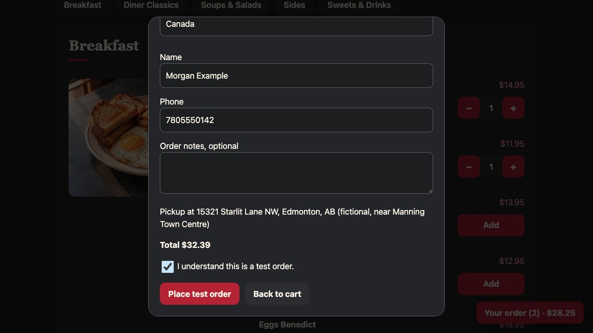

# dyws

**Do You Want Something?** A reusable ordering and delivery system for a business’s own website.

**Release: 0.10.0** · [Download the install ZIP](https://github.com/Starlit-Digital/dyws/releases/download/v0.10.0/dyws.zip) · [Release notes](CHANGELOG.md) · [Installation guide](INSTALL.md) · [Hosted diner example](https://sltd.ca/diner/)

The customer orders on your website, the business manages the order, and an assigned driver handles the delivery. Starlit Diner is the fictional restaurant example. The catalog also supports general products and services sold in whole units.

This is a development preview. Orders and delivery workflows work against persistent storage, but payments are demonstrations or Stripe sandbox transactions. Native mobile apps and production dispatch operations are not shipped. The repository and release downloads are private and require authorized GitHub access.


## Install or run

For a merchant installation, download `dyws.zip` from the release, extract it, and serve **only `public_html/`** over HTTPS. Keep `var`, `server`, `modules`, `plugins`, and `vendor` outside the web root. Open `/setup/`, supply the private setup key, choose your administrator password and catalog, and finish installation. Setup removes itself and locks out repeat installation. The ZIP includes the pinned PHP dependencies.

Requirements: PHP 8.1 or newer, PDO SQLite, OpenSSL, curl, mbstring, and a writable private storage directory. See [INSTALL.md](INSTALL.md) for shared hosting, permissions, upgrades, and recovery precautions.

For a local developer demo:

```sh
git clone git@github.com:Starlit-Digital/dyws.git
cd dyws
composer install --no-dev
npm run setup
npm run serve
```

Open `http://127.0.0.1:8097/`. The CLI creates a disposable demo driver and generated credentials in ignored `var/LOCAL-ACCESS.txt`. Browser installation creates no default password or driver account. Node.js and Python 3 run tests and packaging tools; Node.js is unnecessary for ordinary PHP hosting. The optional WebSocket relay requires Node.js 22 or newer on a separate compatible server.

## Complete feature breakdown

### Customer ordering

| Area | Included behavior |
| --- | --- |
| Catalog | Categories, items, descriptions, images with alternative text, prices, SKU, unit labels, availability, option labels and priced variants. Private JSON is the source of truth. |
| Host integration | Reusable PHP rendering functions, JavaScript modules, `<dyws-ordering>`, scoped `dyws` CSS classes and theme variables. Hosts can render selected categories and hydrate existing panels. |
| Diner example | Five categories with seven items each, category photographs, a diner hero, responsive layout, and fictional business details. |
| Display preferences | The diner provides an adjustable light to dark palette and an 18 to 24 pixel font size control, with generous touch targets. |
| Cart | Visible item quantities, increment and decrement controls, removal icons, options, subtotal, tax, delivery fee and final total. |
| Checkout | Pickup or delivery, customer name, phone, structured street address, optional unit, city, province or state, postal code, country and order notes. |
| Server validation | Product and option validation, quantity limits, integer cent calculations, authoritative pricing and idempotent order submission. Client totals are not trusted. |
| Confirmation | A unique order reference and a private order status page after checkout. The tracking token handoff leaves only the order reference in the page URL. |
| Progress | Received, Preparing, Ready, On the way and Delivered stages, with pickup completion and cancellation states. Driver completion updates the customer view. |
| Arrival estimates | Google route estimates when a current driver location and usable route are available. Otherwise the page explains when an estimate can be shown. |
| Update recovery | Automatic polling or optional WebSocket updates, refresh on return to tracking, recovery from stalled reads and clear delayed update messages. |

### Business administration

| Page | Included behavior |
| --- | --- |
| Entry and sign in | `/admin/` is the natural entry. Protected PHP pages redirect to `/auth/` before emitting admin markup. Successful sign in opens Orders. |
| Orders | Active orders first, compact DataTables search, sorting, pagination and filters for status, fulfillment and payment. Completed and cancelled orders remain accessible. |
| Order details | Customer contact and delivery address, ordered items, notes, allowed status transitions, driver assignment, payment status and delivery location details. |
| Reports | Date range, currency and fulfillment filters; previous period comparisons; order and payment charts; active, completed and cancelled totals; popular items; preparation and delivery durations; daily and hourly tables. |
| Exports | CSV report data and downloadable SVG charts. Report definitions distinguish ordered value, test collections, refunds, tax and delivery fees. |
| Catalog editor | Add, rename, reorder and remove categories, items and options; edit descriptions, image paths, prices and availability; save validated JSON with revision conflict checks. |
| Drivers | Add, edit and deactivate driver accounts, update credentials, inspect assigned active orders and view individual location panels. An open account editor remains protected during refreshes. |
| Password | Change the administrator password using the current password. Password changes revoke admin sessions. Background refresh never repopulates password fields. |
| Settings | Business name, platform display name, pickup address, tax, delivery fee, timezone, and arbitrary singular and plural role labels. Currency is displayed from the catalog. |
| Plugins | Discover bundled plugins, activate or deactivate them, view status and open their settings. Stored plugin configuration survives deactivation. |
| Automatic refresh | Admin views refresh when returning to a visible tab or window and when connectivity returns. Clean forms update independently; unsaved values, focused fields and open editors defer replacement. |
| Edit protection | Saved revisions remain attached to drafts. A read that overlaps typing, saving or explicit reload cannot overwrite newer edits. Deferred changes produce a notice. |

### Driver and delivery flow

Drivers sign in at `/driver/` and see only assigned deliveries available to their account. The console shows the delivery address, phone, notes and pickup or completion actions. Status transitions are checked by the server.

Browser GPS starts automatically for an assigned delivery that is on the way, subject to browser permission. Location is scoped to the assigned active order. The admin and that order’s customer can see its position, timestamp and stale position warnings. Completion and sign out stop location sharing. A private simulated origin is available for testing without sharing a person’s location.

The console refreshes on tab return, window focus and reconnection. Reliable GPS while a phone is locked or an app is in the background requires the planned native apps; the browser console does not provide that guarantee.

### Bundled plugins and extension points

| Plugin | Features |
| --- | --- |
| Google Maps | Driver and destination markers, driving routes, estimated travel time, location and route caching, fallback links, and private plugin settings for the browser key and map ID. |
| Stripe | Optional sandbox hosted Checkout, signed webhooks, server payment verification, idempotency, encrypted credentials and settings owned by the plugin. No live payment keys in this demo. |
| Order Reporting | Reporting dataset, business metrics, period comparisons, charts, CSV and SVG exports, dashboard controls and report integration hooks. |
| DataTables | Locally bundled table search, sort, pagination and in memory table state. No runtime CDN dependency or customer records in browser table storage. |

The [plugin system](docs/plugins.md) provides lifecycle, discovery, settings, authenticated routes, validators, filters, actions, UI slots and providers. The [32 hook contracts](docs/plugin-hooks.md) cover catalog validation and display, checkout fields and validation, order creation and transitions, assignment, tracking, lookup, API responses, driver tools, reporting datasets, controls, cards, exports and tables. The [gift note example](examples/plugins/gift-note) demonstrates a custom plugin.

Native PHP `#[Provides(...)]` attributes describe plugin features. Page `#[Requires(...)]` attributes declare what each page consumes. The resolver loads matching browser assets while keeping required backend validation and authorization active. A new page does not need every plugin’s browser code.

### Storage, security and performance

| Area | Implementation |
| --- | --- |
| Persistence | SQLite stores orders, line items, events, payment records, accounts, sessions and active location records. Private JSON stores the catalog, site configuration and plugin settings. |
| Access | Tenant scoped APIs, manager and driver roles, assignment checks, private customer tracking tokens, password hashes, session revocation, login rate limits and CSRF protected browser sign in. |
| Payments | Manual test capture and full refund records, or configured Stripe sandbox Checkout. Browser redirects never mark a Stripe order paid. |
| Time | UTC timestamps internally; an administrator selected timezone for local display and reporting boundaries. |
| Initial rendering | PHP supplies authorized initial data and readable page previews. JavaScript handles updates, actions, maps and interactive controls. Skeletons cover controls while they initialize. |
| Assets | Page specific editor imports, plugin feature resolution, generated module preloads and revalidated static assets. Authenticated HTML and API responses use no store caching. |
| Communication | HTTPS polling works on ordinary PHP hosting. An optional scoped WebSocket relay provides invalidations and RPC, with HTTP fallback and no automatic replay of uncertain writes. |
| Diagnostics | Opt in `?diagnostics=1` measurements for startup, API reads, rendering and maps, without recording tokens, request bodies or customer contact details. |
| Installation | A single ZIP with dependencies and a file hash manifest, or Git plus Composer. Ownership key setup, administrator creation, installer removal and reinstall protection. |
| Maintenance | Documented backups, account migration, cleanup tooling and separate private runtime storage. These tools are not automatically scheduled by installation. |

## Screenshot examples

All images below were captured from this release’s local demo on October 23, 2026. Names, phone numbers and addresses are fictional. No live customer records, real credentials, Maps keys or tracking tokens appear. The Google Maps API is unconfigured in this screenshot fixture, so its screens do not demonstrate a live route estimate.

### Business owner

**Orders:** active work appears first, with filters and searchable rows.


<details>
<summary>Reports, Catalog and Plugins examples</summary>

**Reports:** business metrics, charts and drill down tables.


**Catalog:** category and item editing backed by private JSON.


**Plugins:** bundled feature activation and settings links.


</details>

### Driver

**Sign in:** a driver ID and password, separate from administrator access.


**Assigned delivery:** customer details and the action to start the test delivery.


### Customer ordering process

1. Browse category panels and add items. Product quantities remain visible.


2. Review quantities and totals in the cart.


3. Choose pickup or delivery and provide contact and address details. This example shows the final checkout section with the test acknowledgement.



4. Place the test order and follow its private status page.


5. When the assigned driver completes delivery, the same page confirms completion and removes active location tracking.


## Integration and project layout

| Path | Purpose |
| --- | --- |
| `public_html/` | The only public document root, containing PHP pages, assets and thin site adapters. |
| `public_html/dyws/` | Reusable JavaScript modules, web component and scoped CSS. |
| `modules/dyws/php/` | Private reusable rendering, storage, authorization and plugin code. |
| `modules/dyws/realtime/` | Optional separately hosted Node.js WebSocket service. |
| `plugins/` | Private bundled plugin implementations and manifests. |
| `public_html/plugins/` | Matching browser assets for bundled plugins. |
| `examples/` | Diner and general store catalogs, PHP host integration and plugin examples. |
| `var/` | Ignored runtime data and credentials. Never publish this directory. |
| `docs/` | Architecture, APIs, deployment, screenshots, plugin contracts and plans. |

Use [the PHP module calls](docs/dyws-module.md) to render categories and item panels in your own host page. Supply the host endpoint and authenticated tenant configuration to the browser package. Use the current `dyws` identifiers and directory routes; obsolete HTML routes and earlier component names are not supported.

## Verification and releases

```sh
npm test
npm run test:realtime
npm run build:zip
npm run verify:release
DYWS_INSTALL_ARCHIVE="$PWD/dyws.zip" python3 tests/installer.test.py
```

`VERSION`, the root package and the browser package share the application version. Bundled plugins and the optional relay retain their own component versions. The builder checks version alignment, includes the locked PHP dependencies, excludes runtime files and writes `MANIFEST.json` inside the ZIP. Stage new source files before building.

Release work uses separate commits with detailed messages and annotated tags. For 0.10.0, the documentation and version preparation commits have `v0.10.0-docs` and `v0.10.0-version` tags. The final packaged commit is tagged `v0.10.0`. The GitHub release contains `dyws.zip` and `SHA256SUMS`. See [release notes](CHANGELOG.md) for included changes and verification.

## Current limits and next steps

This preview does not include native iOS or Android apps, guaranteed background GPS, a hosted WebSocket service, automatic dispatch optimization, driver payouts, marketplace settlements, production payment processing, SMS or email notifications, stock management, or a managed backup service. Google Maps needs a configured key and billing account. Stripe requires configured sandbox credentials and signed webhook delivery.

The server enforces tenant boundaries, but the shipped installation is configured for one business; there is no platform owner interface for provisioning multiple businesses. Review operations, retention, privacy, monitoring, recovery, payment compliance and mobile delivery reliability before a production pilot. The hosted diner currently demonstrates HTTPS polling and a simulated origin, not real delivery operations.

## Documentation

- [Installation and upgrades](INSTALL.md)
- [Backend architecture](docs/architecture.md) and [HTTP API](docs/api.md)
- [Reusable module integration](docs/dyws-module.md) and [CSS system](docs/dyws-styles.md)
- [Catalog and payment setup](docs/catalog-and-payments.md)
- [Plugin development](docs/plugins.md) and [hook reference](docs/plugin-hooks.md)
- [Report definitions](docs/order-reporting.md)
- [GPS, Maps and realtime](docs/gps-maps-realtime.md)
- [Deployment and validation](docs/deployment.md)
- [Startup diagnostics](docs/load-diagnostics.md) and [performance measurements](docs/performance-2026-10-23.md)
- [Driver mobile app plan](docs/mobile-driver-plan.md)
- [Screenshot provenance](docs/screenshots/README.md)

The private repository is [Starlit-Digital/dyws](https://github.com/Starlit-Digital/dyws). Earlier names were restaurant-ordering and starlit-go; Git history is preserved. The Cravings & Delight website remains a separate project.
