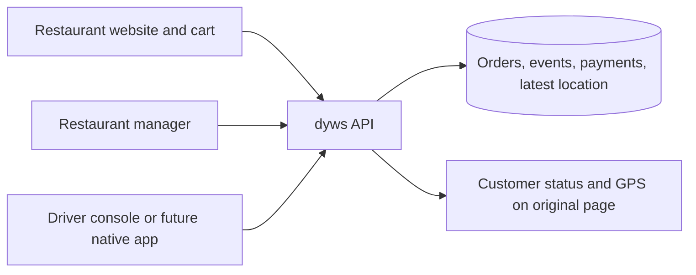
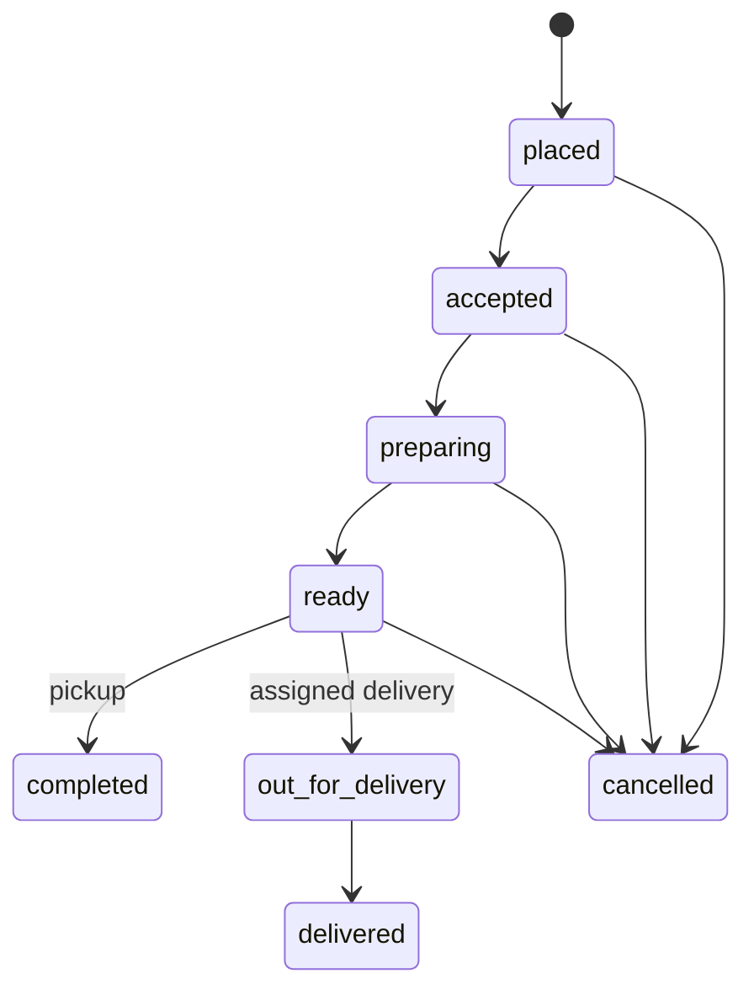

# Backend foundation

## Runtime and layout

PHP 8.1 or newer with PDO SQLite, compatible with the current shared host. No server package dependencies. JavaScript modules handle the example surfaces. Existing diner visuals and accessibility settings remain intact.

- `public_html/` is the Starlit Diner example and its customer, manager and driver web surfaces.
- `public_html/ordering/` is the reusable menu ordering component.
- `public_html/platform/` connects the example surfaces to the API.
- `public_html/api/index.php` is the HTTP boundary.
- `server/` is private application code, schema, setup and cleanup tooling.
- `var/` holds ignored local config, access details and runtime database files.
- `examples/starlit-diner/README.md` describes the reference integration.

## Order contract

The API ignores browser submitted prices, totals and restaurant names. It resolves item IDs and variant IDs against the server catalog, validates quantities and computes subtotal, delivery fee and GST in integer cents. The demo fee is 395 cents and the example tax basis is 500 basis points. No real financial service is connected.

Creation and status mutations use immediate database transactions. Order request keys are unique per tenant. A repeat of the same canonical request returns the same order and tracking token; a changed request with the same key is rejected. The example frontend retains its request key when retrying an unchanged submission within the same checkout session. Network failure across a full page reload still needs a persisted pending submission flow before launch.

An assigned driver can start or finish only their delivery. Completion requires a recorded test payment. Manager actions and test payment entries are separate from order preparation status. This prototype supports one capture and one full refund per order, not partial refunds. Cancelling a paid order does not automatically create a refund; the manager explicitly records the test refund.

## Reporting definitions

Order count, ordered value, average order value, active count, cancelled count and top items are based on order creation date. Ordered value includes unpaid and cancelled orders and is not revenue. Popular items exclude cancelled orders and count ordered quantities regardless of payment. The dashboard labels these distinctions. Average preparation measures accepted to ready; average delivery measures out for delivery to delivered, using only orders with both events. These are observed event durations, not promises or route ETAs. Fulfillment and status counts are also available in the API.

Payment collections and refunds use payment event date. Net collections equals captures minus refunds. Net product sales, net tax and net delivery fees use the corresponding signed amounts, and their sum reconciles to net collections. These are test operational metrics, not formal accounting statements. The date range is interpreted in America/Edmonton and converted to inclusive start and exclusive end timestamps. All timestamps are stored as Unix seconds.

## Access and privacy boundaries

Manager and driver passwords are hashed in private configuration. Random bearer session tokens expire after eight hours and are stored hashed in SQLite. Login and order creation are rate limited. The browser keeps operator tokens in tab session storage, not in URLs. Production authentication needs named accounts, rotation, MFA, device revocation and shorter access tokens with refresh sessions.

Tracking links contain an order ID plus a secret in the URL fragment. The secret goes to the API in X-Tracking-Token, not a query parameter. Tracking tokens are stored as digests and expire after 24 hours. Public responses omit the customer’s name, phone, address, notes and driver identity. Links are bearer capabilities and anyone with a link can view that order’s status while valid.

Every order query is tenant scoped; the first deployed configuration serves only the fictional diner. Tenant isolation is tested, but self service tenant onboarding is not implemented. Do not accept a client supplied tenant as authorization.

GPS is accepted only for the assigned active delivery. Latitude, longitude, accuracy and timestamp are validated. Old or out of order positions are rejected. The API stores the latest position only, hides it after 15 minutes and deletes it on completion or cancellation. The cleanup CLI removes expired positions and sessions and scrubs demo customer contact fields after seven days. Cleanup is implemented but not scheduled automatically; configure a host scheduler before relying on physical deletion of abandoned demo data.

The demo map uses the existing attributed Manning reference image with a Mercator projection approximation. There is no routing, geocoding, turn by turn navigation or ETA computation. Outside its bounds, the UI shows coordinates rather than placing a misleading marker. Replace it with a proper licensed map adapter for a broader deployment.

## Deliberate boundaries

No production checkout, payment processing, inventory, driver payouts, push delivery, route optimization, automatic dispatch, customer accounts, POS synchronization or native apps are claimed. SQLite is suitable for this small pilot; migrate to a managed transactional database and event outbox for a busy multi restaurant platform. Database migrations need versioned deployment tooling beyond the current additive schema initialization.

## Generic catalog and payment connector

The private JSON catalog and Stripe connector extend this foundation. See catalog-and-payments.md for the current product schema, sandbox payment workflow, reconciliation definitions and secret storage. Stripe is optional per new order. Historical orders retain their original provider and currency. The diner is a branded example of the generic starlit-ordering component.
