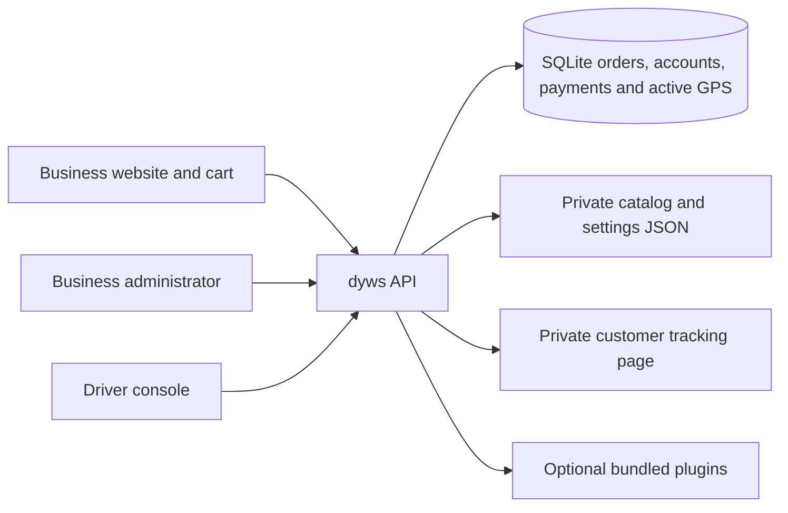
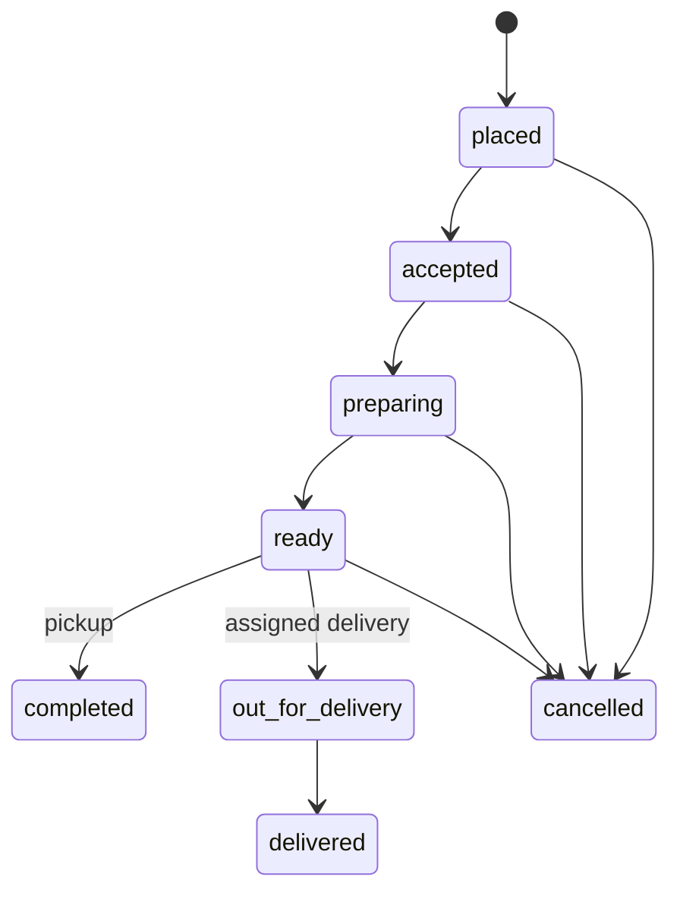

# dyws architecture

The application release is recorded in [VERSION](../VERSION). dyws is a generic ordering and delivery platform; Starlit Diner is its fictional host example. The current build is a development preview with manual test payments or Stripe sandbox Checkout.

## Runtime and layout

PHP 8.1 or newer requires PDO SQLite, OpenSSL, curl and mbstring. Composer installs the locked Stripe PHP SDK. The website needs no Node.js service or frontend build. Node.js and Python run the development tools and tests; the optional WebSocket relay requires Node.js 22 or newer.

| Path | Responsibility |
| --- | --- |
| `public_html/` | The only document root, with PHP pages, host assets and thin API adapters. |
| `public_html/dyws/` | Reusable JavaScript modules, cart component and scoped CSS. |
| `public_html/platform/` | Host adapters supplying endpoints, page roots, navigation and startup data. |
| `modules/dyws/php/` | Private catalog rendering, storage, authorization, installation and plugin services. |
| `plugins/` and `public_html/plugins/` | Private and public halves of bundled plugins. |
| `server/` | Private bootstrap, CLI setup, migrations and cleanup adapters. |
| `modules/dyws/realtime/` | Optional separately hosted WebSocket relay. |
| `var/` | Ignored configuration, JSON settings, credentials and SQLite data. |

## Pages and initial data

The homepage is `home.php`; named pages use `page.php` and directory URLs. `/admin/` redirects to Orders when authenticated, otherwise to `/auth/`. Every admin page checks its session before emitting navigation or private markup. Successful sign in opens Orders. The seven admin pages are Orders, Reports, Catalog, Drivers, Password, Settings and Plugins.

PHP supplies initial authorized data and readable previews for admin, driver and tracking pages, plus the public storefront catalog. JavaScript enhances controls and handles actions, updates and saves. Skeletons cover controls and maps while they initialize. PHP `Provides` and `Requires` attributes select browser plugins per page; backend registration and required validation remain active independently.

Operator and customer views refresh when revisited or reconnected. Admin form guards defer replacement of unsaved or focused fields and open editors. Saved revisions remain attached to drafts so a later save still detects concurrent changes. See [loading diagnostics](load-diagnostics.md) and [plugin manifests](plugins.md).

## Order contract

The server resolves product and variant IDs against the private catalog, validates quantities, and calculates prices, configured tax and delivery fees in integer cents. Browser submitted prices are not authoritative. The diner seed uses a 395 cent delivery fee and 500 basis point example tax; these are editable business settings.

Order creation and status changes use SQLite transactions. An idempotency key is unique per tenant. Repeating the same canonical request returns the same order and tracking token; changing the request with the same key returns a conflict. The cart retains its request key for retries within the current checkout session. Persisting an uncertain submission across a full page reload remains future work.

Only the assigned driver can start or finish a delivery. Completion requires payment recorded by the appropriate provider. Manual demo orders support one test capture and one full test refund. Stripe sandbox orders rely on verified webhooks and support cumulative partial or full refunds. Managers cannot manually mark Stripe orders paid. Cancellation does not itself refund a payment. See [payment contracts](catalog-and-payments.md).

## Storage and access

SQLite stores orders, item snapshots, events, payment records, driver accounts, administrator password hashes, sessions, active GPS, sharing sessions and optional remembered guest details. Private JSON holds catalog, site configuration, general settings and plugin settings. Account migration imports older credential files once; current writes go to SQLite. See [installation and upgrades](../INSTALL.md).

Random operator bearer sessions expire after eight hours and are stored as hashes in SQLite. PHP sign in forms use CSRF protection and HttpOnly page cookies; browser API clients use the associated bearer session in tab session storage. API requests still require explicit authorization. Password changes and sign out revoke the underlying sessions. Named administrator accounts, MFA and native device session management remain future work.

A private customer link contains an order ID and tracking token in its fragment. The tracking page exchanges them through POST for an order scoped HttpOnly cookie and redirects to `tracking/?order=ORDER_REFERENCE`. API reads use `X-Tracking-Token`. Tracking credentials expire after 24 hours and are bearer capabilities. The customer projection includes the delivery address for routing, status, payment state and active GPS; it omits customer name, phone, notes and driver identity. Never treat this page as public order lookup.

All queries are tenant scoped, but the shipped installation serves one configured business. Self service tenant provisioning is not implemented. Private HTML and API responses use `no-store`.

## Location, routes and communication

GPS uploads require the assigned active delivery, a driver session and a sharing token. Sharing expires after two minutes without an authenticated upload or heartbeat. Heartbeats never change a measurement timestamp. API requests prune expired sharing records; completion, cancellation and logout remove access. The latest fix is retained rather than a location trail, labelled stale after 60 seconds and hidden after 15 minutes at the latest. Disconnected browser views clear markers after two minutes without a successful snapshot.

The Google Maps plugin provides maps, destination markers, traffic aware routes and approximate arrival times. A fresh position and usable route are required for an ETA. Missing, stale or simulated positions are labelled explicitly. Estimates never finish an order. A private test origin can replace device GPS for demonstrations; it is absent from fresh installation defaults. See [GPS and maps](gps-maps-realtime.md).

HTTPS polling works on ordinary PHP hosting. The optional WebSocket relay supplies scoped invalidations and RPC, with HTTP fallback. Safe reads recover after timeouts; uncertain writes are not automatically replayed. The hosted demo uses polling.

## Reporting and operations

Order Reporting supplies comparisons, daily and hourly charts, CSV and SVG exports, item summaries and observed preparation and delivery durations. Its ordered value excludes cancelled orders. Core fallback totals retain their own definition, including cancelled ordered value. Payment metrics use payment event dates, separately from order creation cohorts. See [exact report definitions](order-reporting.md).

UTC timestamps are stored as Unix seconds. Settings selects the IANA timezone used for display and calendar report boundaries. Changing the timezone never rewrites stored instants.

The cleanup CLI removes expired sessions and location records and scrubs demo customer contact fields after seven days. It is not scheduled automatically. Backups, restore drills, production monitoring, queues and reliable native background GPS remain operational work. The preview does not include live payments, payouts, inventory reservation, automated dispatch, customer accounts or native mobile apps.

## Remembered checkout details

`GuestDetails` owns a separate browser capability, profile and structured address book. It does not use operator or tracking sessions. `guest-details.js` owns the checkout controls and keeps fetched contacts only in page memory. The first party HTTP adapter handles the HttpOnly cookie; the realtime relay never receives it.

Explicit consent saves validated details in the order transaction. Each new successful order renews the profile and cookie for 180 days. Replays of the same order do not renew or recreate data. Foreign profile and address IDs cannot cross the capability boundary, and stale forms cannot silently recreate removed data. Forget cascades to all addresses while preserving business order records. Terms and removal controls remain available outside checkout at `terms/`.

## Checkout and operational presentation

`component.js` owns the custom element, cart, dialog and adapter boundary.
`checkout.js` owns checkout mounting and validation, `checkout-fields.js` owns
persistent labels and inline field errors, `pickup.js` owns availability and
optional directions, and `order-review.js` owns review, edits and confirmation.
Guest and plugin setup must finish before Review is enabled in the shared
component. Site builds no longer patch this lifecycle.

`order-priority.js` defines the browser work queue. Immediate orders are due at
creation; scheduled pickups are due for preparation 30 minutes before pickup.
The Store query uses the same sort before its 200 row limit. Active work comes
first in ascending due order, followed by finished orders newest first. Manager
Due now and Scheduled views divide active work using that preparation time;
Completed includes completed pickups and delivered orders. All includes cancelled
orders. These views do not change statuses, send notifications or dispatch orders.
