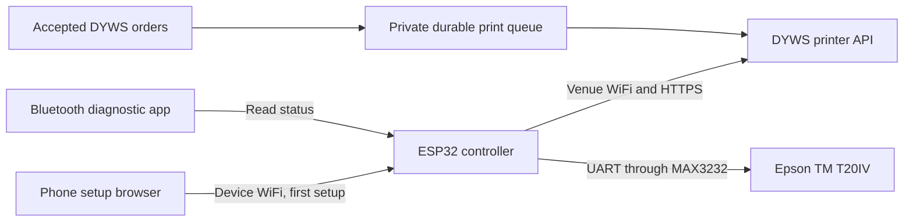

# Order Printer pilot

Implementation and research recorded October 24, 2026. The plugin remains inactive by default. Nothing in this change deploys it to a live venue, purchases hardware, or changes demonstration payments into real charges.

## Executive decision

Use the Arduino compatible **DFRobot FireBeetle 2 ESP32-E N16R2**, with the **Epson TM-T20IV C31CL47001** USB and RS232 printer for the venue pilot. Connect the phone to the ESP32's own protected WiFi for setup, then let the ESP32 communicate directly with the DYWS backend over HTTPS. Retain BLE for device diagnostics. The phone can leave after setup.

The Epson is the practical upgrade from the DFRobot embedded printer: 80 mm paper, automatic partial cutting, a much larger roll and a complete serviceable housing. Its stated maximum print speed is 250 mm/s; the pilot firmware deliberately sends text more slowly while checking status. Use the original printer housing in a printed cradle with a separate accessible electronics compartment. Manufacturer dimensions are **146 × 199 × 146 mm**, not the 140 mm width of the older TM-T20III. Allow the lid to open completely and keep the paper exit clear. [Epson technical reference](https://files.support.epson.com/pdf/pos/bulk/tm-t20iv_trg_en_rev_c.pdf)

The original DFRobot DFR0503-EN remains useful for a compact prototype. Its 58 mm paper and manual tear require more staff handling. Its 30 mm maximum roll diameter means frequent roll changes compared with the Epson. [DFRobot product and datasheet](https://www.dfrobot.com/product-1799.html)

## Costs and purchasing

The [complete Canadian parts basket](order-printer-canadian-parts-research-20261024.md) totals **C$380.06 before tax and delivery**, including the C$259 printer, C$21.75 controller, C$10.95 MAX3232, serial connector and cable, C$11.95 official USB-C supply, programming cable, setup button, wiring, hardware packs and a full 1 kg PETG spool. Prices were checked on October 24, 2026. The budget assumes the regional printer bundle includes its Epson power adapter, AC cord, USB cable and starter paper; confirm the selected seller's carton contents before paying.

The basket buys more filament, wire and hardware than one unit consumes. It uses nine storefronts, so delivery can be substantial. An optional six supplier basket costs about C$385.60 before tax and delivery, with button and foot substitutions that need mechanical verification. Both options and their purchase links are in the research file. The October 28 enclosure revision changes the fasteners and rubber pad count, so reconcile its hardware schedule before ordering. No order has been placed.

Shared tools, CAD work, assembly labour, printing services and site infrastructure are excluded. The [plain text handoff](hardware/order-printer/prototype-handoff-20261024.txt) gathers the complete specifications, parts, wiring, enclosure requirements and remaining fit checks for the designer and assembler.

## Printed enclosure

The current [open ring and sidecar package](hardware/order-printer/sidecar-180/README.md), updated October 28, follows the owner's simplified design. Two long rails and two end crosspieces support the printer without a floor plate. Corner gussets provide padded support. The electronics box hooks over one rail using two integral rabbets, secured with one retaining screw.

The ring measures **160 × 214 mm** assembled. It prints as two **160 × 107 × 12 mm** halves, joined with two small vertical straps. The case prints at **75 × 128 × 32 mm**, including its hooks; its lid is **62 × 128 × 2.4 mm**. Every part and arranged 3MF plate fits a **180 × 180 × 180 mm** machine with a 5 mm brim allowance. The full assembly footprint is about **229 × 214 mm**, excluding rear cables.

The six final printed pieces calculate to **188.1 g of standard PLA at 1.24 g/cm³**. All three fit pieces add about **19.9 g**. With a 20 percent printing allowance, reserve **250 g**. This is a geometry based calculation, not a slicer result. Physical fit, load capacity, heat and RF performance still require a prototype. Keep both mains adapters external and check actual printer support points before use.

The package contains STLs, three arranged final print plates, a separate fit test plate, editable source and a CAD preview. Use the new guide's fastener schedule. The earlier full cradle and its 375.4 g PLA calculation remain as historical alternatives.

Additional paper is quoted at C$87.99 for twelve 68.58 m rolls in the dated parts research. A 250 mm order consumes about C$0.027 of paper before feed and waste. No ink or toner is required. At five second polling, one continuously powered device makes up to 17,280 polls per day; check hosting capacity as the fleet grows.

## Delivered software

The optional `order-printer` plugin adds a manager settings panel, expiring pairing codes, revocable device credentials, location assignment, two printer profiles, status, test tickets, a durable SQLite queue and explicit recovery actions. It does not add a new core dependency. Browser code lives in `public_html/plugins/order-printer`; server code and schema live in `plugins/order-printer`.

The firmware in `firmware/order-printer` implements a protected setup access point, local phone setup page, verified HTTPS enrollment and polling, persistent configuration, BLE status, serial status queries, text printing and Epson cutting. Credentials stay on the device and as hashes on the server. Pairing codes expire after 30 minutes. Payloads are ordinary text; neither arbitrary printer commands nor remote scripts are accepted.

No email adapter is used. Direct backend integration preserves authoritative order IDs, payment state, location and cancellation status. The queue catches missed optional status hooks during later polling, so a failed observer does not lose accepted orders.

## API and queue contract

All paths below use the normal DYWS `/api/?route=...` adapter. POST bodies are JSON. Manager endpoints require the existing manager session. Device endpoints use their separate `X-DYWS-Printer-Token` header. A manager token alone does not authenticate a printer.

| Method and route | Contract |
| --- | --- |
| GET `/manager/plugins/order-printer/settings` | Safe device and job summaries, locations, profiles and configured API base. No credentials or ticket contents. |
| POST `/manager/plugins/order-printer/devices` | `{name, locationId, profile}`. Returns `{id, enrollmentCode, expiresIn, apiBase}`. Profiles are `dfrobot58` and `epson80`. |
| POST `/manager/plugins/order-printer/manage` | `{printerId, action, jobId?, requestId?}`. Actions: `test`, `revoke`, `resolve`, `dismiss`, `reprint`. Test and reprint require a stable caller generated request ID. |
| POST `/plugins/order-printer/enroll` | `{code, token, deviceId}`. Device generates a 64 character random hex token. Same code, device ID and token can retry until expiry. Returns profile and printer ID. |
| POST `/plugins/order-printer/poll` | `{status}` where status is `ready`, `paper_out`, `printer_unavailable` or `uncertain`. Returns `job:null` or `{id, lease, text, profile, cut}`, plus profile, attention and polling interval. |
| POST `/plugins/order-printer/ack` | `{jobId, lease, action}` with `start`, `sent`, `uncertain` or `release`. Returns `{ok,state}`. |

Errors use the core error response: invalid data 422, missing or revoked device auth 401, a foreign tenant or printer job 404, invalid lease or state 409, oversized request 413. All public device routes use custom authentication or the enrollment capability. Enrollment and device requests have core rate limits. The rate limit buckets are IP based, so assess shared NAT traffic before larger deployments.

Only new orders placed after the printer configuration was created become automatic tickets. A persisted event cursor avoids replaying earlier orders even within the same timestamp second. Orders must match the assigned location, be accepted, preparing or ready, and have confirmed payment. The existing demonstration provider also permits its explicitly unpaid test ledger state. Placed, cancelled, completed and non-demo unpaid orders do not print. Do not reset or renumber the core event log while retaining printer configurations.

A unique printer and order key prevents duplicate automatic jobs. Polling grants one 90 second reservation. `start` must succeed before physical output; it grants a 180 second printing window. An expired unstarted reservation can return to the queue. A started job whose outcome is unknown becomes `uncertain`, blocks further jobs for that printer and requires review. The manager can confirm the paper, dismiss it or request a marked copy. `sent` and uncertain recovery acknowledgements can safely repeat. The service does not promise exactly once physical printing.

Tickets are kitchen slips with the order identifier, creation time in UTC, fulfillment type, customer name, line items, options, notes and test payment summary. They exclude phone, delivery address and tracking credentials. All current tickets explicitly say `DEMONSTRATION ORDER`. The first version uses ASCII transliteration and fixed profile widths. Custom layouts, delivery labels, receipt tax formatting and full Unicode need separate work.

Cancellation stops queued work, but does not recall paper already printed. This version does not print followup cancellation or amendment slips. Staff must continue to check the DYWS order screen. Orders still active after a long outage can print on reconnection, so a stale order review threshold is a production requirement.

## Deployment and next steps

Activate only in a private pilot installation. The public demo lockdown policy intentionally does not allow this plugin. Back up the private SQLite database; the plugin creates its own tables on first use. Deactivation removes its routes but retains configuration and jobs. Revoking a device invalidates its token. No active default plugin list was changed.

Set `public_base_url` to the externally reachable HTTPS origin and any deployment subpath. The device accepts the resulting address ending in `/api/`. Include plugin server files, browser assets and generated preload entries. The release builder includes firmware source when it is tracked; no install archive was published by this change.

Follow the [firmware build and wiring instructions](../firmware/order-printer/README.md). Next, bench test the actual printer and controller, validate recovery under injected failures, produce measured enclosure CAD, then run a supervised venue pilot. Production readiness also needs signed updates, secure device provisioning, fleet alerts, payload retention, stale order policy and a support workflow. Existing hosting can run a small pilot; dedicated infrastructure, support labour, spares and backup power are additional operating costs.
